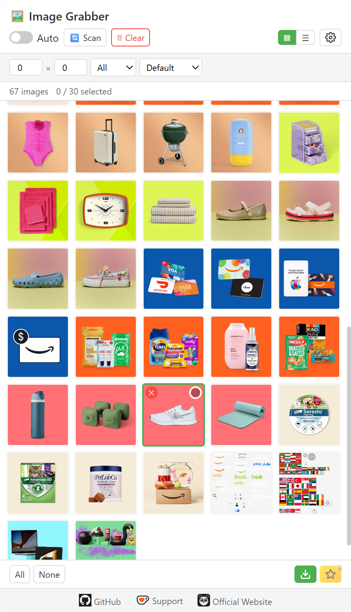

# Image Grabber

[English](README.md) | [中文](languages/README_zh.md) | [Español](languages/README_es.md) | [Deutsch](languages/README_de.md) | [日本語](languages/README_ja.md) | [Français](languages/README_fr.md)

**Image Grabber** is a free image downloader extension for Chrome & Edge that scans any webpage and batch-downloads its images in one click.

> Chromium-based · Manifest V3 · No tracking · Side Panel UI

---

## Features

### Free Features

| Feature | Description |
|---------|-------------|
| 🔍 **Smart Image Detection** | Scans `` (including `data-src` / lazy-load attributes), `srcset` (picks the largest candidate), CSS `background-image` (inline, `::before` and `::after`), `<video poster>`, `<source srcset>`, and SVG `<image>` |
| 🤖 **Auto Collect** | Continuously collects images as the page loads (MutationObserver + idle callback) |
| 📋 **Grid & List View** | Switch between thumbnail grid and compact table view |
| 🔎 **Filter & Sort** | Filter by minimum width/height and image type; sort by width, height or file name |
| 🎯 **Manual Pick** | Click exact elements on a page to grab their image |
| 🖼️ **Lightbox Preview** | Full-size preview with keyboard navigation (← → Esc), download and copy-URL actions |
| 🔗 **Copy URLs** | Copy the selected image URLs (or all filtered ones) to the clipboard |
| 📥 **Batch Download (30 max per batch)** | Downloads go through the browser's own download engine, so session cookies, User-Agent and Referer are handled automatically — images behind hotlink protection or login sessions save correctly |
| 📊 **Download Result Report** | When a batch finishes, a toast reports how many files succeeded and how many failed |
| 💾 **Persistent State** | Image lists and your "removed" marks survive page reloads and service worker restarts |
| 🔄 **SPA Support** | Auto re-scan on SPA navigation (`pushState` / `replaceState` / `popstate`) |

### Premium Features (License Required)

| Feature | Description |
|---------|-------------|
| ⭐ **Unlimited Selection** | No 30-image limit — select and download as many as you want |
| 🔬 **pHash Deduplication** | Perceptual hash detects duplicate/similar images even when their URLs differ |
| 🔄 **Format Conversion** | Convert on download: WebP → JPG, PNG, or any supported format |
| 🗜️ **Image Compression** | Adjust quality and max width to reduce file size |
| 🚀 **Advanced Download Pipeline** | One-click pipeline: dedup → convert → compress → download |

---

### What's New in 2.0.7

- **Search-friendly name & description** — the extension name now contains the exact keyword *Image Downloader*, and the description leads with the search terms people actually type (all 6 languages).
- **Docs & site SEO** — README intro lines and the official product page metadata (description, social share card) were rewritten for search.

### What's New in 2.0.6

- **Protected downloads now really save** — image requests from the panel carry the page's `Referer` via a session-scoped `declarativeNetRequest` rule, but the browser's own download engine does not. On hotlink-protected sites a download could therefore report success while the file on disk was just a 403 error page. Downloads now fetch the image inside the extension panel (with the page's cookies and `Referer`) and hand it to the download engine as a blob, so protected and login-only images save as the real image.
- **Honest success/failure counts** — the completion toast now waits for every download to actually finish and reports the real numbers, instead of counting the ones that were merely started.
- **Advanced Download fixed on protected sites** — the dedup → convert → compress pipeline could not read hotlink-protected images into a canvas. Each image is now read through the same authenticated fetch, so pHash deduplication and format conversion work again, and a file that cannot be re-encoded falls back to the original instead of being dropped.

---

## Free vs Premium

| | Free | Premium |
|---|:---:|:---:|
| Image scanning & browsing | ✅ Unlimited | ✅ Unlimited |
| Copy image URLs | ✅ | ✅ |
| Batch download limit | 30 images per batch | Unlimited |
| Basic download (original format) | ✅ | ✅ |
| Hotlink / login-protected downloads | ✅ | ✅ |
| pHash deduplication | — | ✅ |
| Format conversion (WebP→JPG/PNG) | — | ✅ |
| Image compression | — | ✅ |
| Advanced Download pipeline | — | ✅ |

---

## Preview

  

---

## Supported Browsers

| Browser | Status |
|---------|--------|
| Google Chrome | ✅ Fully supported (Side Panel) |
| Microsoft Edge | ✅ Fully supported (Side Panel) |
| Other Chromium-based browsers | ✅ Supported (Popup fallback) |

---

## UI Surfaces

| Surface | How it opens | What it offers |
|---------|--------------|----------------|
| **Side Panel** | Click the toolbar icon (Chrome / Edge) | Full UI, including the ⚙️ Settings panel where the license key is entered, plus 🎯 **Manual Pick** |
| **Popup** | Opens automatically on browsers without the side-panel API, or if the side panel cannot be opened | Grid/list browsing, filters, selection and downloads |
| **Detached tab** | Opens automatically as a fallback when the side panel cannot be used | Grid browsing, filters, selection and downloads |

---

## Installation

1. Open your browser's extension page:
   - **Chrome**: `chrome://extensions/`
   - **Edge**: `edge://extensions/`
2. Enable **Developer mode** (top-right toggle)
3. Click **Load unpacked** and select the project folder
4. Click the Image Grabber icon in your toolbar to open the side panel

---

## Usage

1. **Browse any webpage** — The content script collects images from the current page
2. **Click the Image Grabber icon** to open the side panel
3. **Enable Auto** — Toggle "Auto" to continuously collect images as the page loads
4. **Or click Scan** — Manually trigger a one-time full-page scan
5. **Filter** — Set minimum width/height, select image type, choose sort order
6. **Switch views** — Toggle between grid (▦) and list (☰) layout
7. **Select** — Click images to select (up to 30 for free users)
8. **Preview** — Click any image to open the lightbox
9. **Copy** — Use the copy button to put selected image URLs on the clipboard
10. **Download** — Click ⬇️ for a basic download, or ⭐ for Advanced Download (premium). A toast reports how many files were downloaded and how many failed

### Advanced Download (Premium)

1. Get your license key at [annmax1983.com](https://www.annmax1983.com/checkout.html?plugin=imagegrabber)
2. Open Settings (⚙️ gear icon) → enter your license key
3. Configure output format, quality, and deduplication options
4. Select images and click the ⭐ Advanced Download button
5. The pipeline will: deduplicate (if enabled) → convert format → compress → download

---

## Privacy

- Required permissions: `storage`, `downloads`, `sidePanel`, `declarativeNetRequest`
- Host permission `<all_urls>` is required to detect and download images hosted on any domain
- `declarativeNetRequest` is used only to set the `Referer` header. The rule is active while a panel displays images from a tab (so previews load on hotlink-protected sites) and during a download batch (so the saved file is the real image, not an error placeholder). It is scoped to the image domains currently on screen, and removed when the panel closes, you switch tabs, or the page navigates
- All image processing runs **locally** in your browser — no external data uploads
- No analytics, user tracking, or remote data collection
- Image data is stored only in your browser local storage
- License validation sends your license key, a random install identifier and basic browser metadata — never your images, page content or browsing data

---

## Copyright Disclaimer

This extension only provides local image resource viewing and downloading capabilities for users' personal offline sorting and reference. All pictures, illustrations, graphic materials on web pages are protected by copyright and intellectual property laws. Users shall not use batch downloaded images for commercial production, unauthorized reprinting, secondary distribution, mass crawling and other infringing behaviors. All civil and legal liabilities arising from improper use shall be borne solely by the user.

## Crawling Reminder

Do not use this tool to batch capture image resources from websites with copyright protection, anti-crawling mechanisms or clear content usage restrictions. Please abide by the website access rules and local laws when scanning page images.

---

## Source Code Notice

> ⚠️ **This repository does not publish source code.** It contains only usage documentation, release notes, and support resources. The extension is distributed exclusively through the Chrome Web Store. No offline installation packages or end-user source code are provided.

---

## License

Copyright © 2026 Image Grabber. All rights reserved.

---

> **Note:** This repository is for **project showcase purposes only**. It does not contain the full source code, manifest, icons, or build scripts. Full source code will **not** be published here.

---

## ❤️ Support the Developer

If you find Image Grabber helpful, consider buying me a coffee!

**[👉 Click here to support](https://ko-fi.com/annmax?ref=imagegrabber)**
