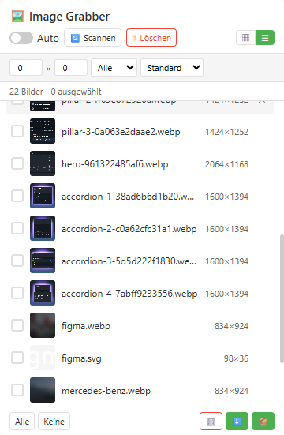

# Image Grabber

[English](../README.md) | [中文](README_zh.md) | [Español](README_es.md) | Deutsch | [日本語](README_ja.md) | [Français](README_fr.md)

**Image Grabber** ist ein kostenloser Bild-Downloader für Chrome und Edge: scannt jede Webseite und lädt alle Bilder mit einem Klick im Batch herunter.

> Chromium-basiert · Manifest V3 · Kein Tracking · Side Panel UI

---

## Funktionen

### Kostenlose Funktionen

| Funktion | Beschreibung |
|----------|--------------|
| 🔍 **Intelligente Bilderkennung** | Scannt `` (inkl. `data-src` / Lazy-Load-Attribute), `srcset` (wählt den größten Kandidaten), CSS `background-image` (inline, `::before` und `::after`), `<video poster>`, `<source srcset>` und SVG `<image>` |
| 🤖 **Auto-Sammlung** | Sammelt Bilder kontinuierlich während die Seite lädt (MutationObserver + Idle Callback) |
| 📋 **Raster- & Listenansicht** | Zwischen Miniaturansicht-Raster und kompakter Tabellenansicht wechseln |
| 🔎 **Filtern & Sortieren** | Nach Mindestabmessungen und Bildtyp filtern; nach Breite, Höhe oder Dateiname sortieren |
| 🎯 **Manuelle Auswahl** | Klicke direkt auf ein Element der Seite, um dessen Bild zu erfassen |
| 🖼️ **Lightbox-Vorschau** | Vollbild-Vorschau mit Tastaturnavigation (← → Esc), Download und URL-Kopieren |
| 🔗 **URLs kopieren** | Kopiert die URLs der ausgewählten (oder aller gefilterten) Bilder in die Zwischenablage |
| 📥 **Batch-Download (max. 30 pro Batch)** | Downloads laufen über die Download-Engine des Browsers, daher werden Session-Cookies, User-Agent und Referer automatisch mitgesendet — Bilder hinter Hotlink-Schutz oder Login-Sitzungen werden korrekt gespeichert |
| 📊 **Download-Ergebnisbericht** | Nach Abschluss eines Batches meldet ein Hinweis, wie viele Dateien erfolgreich waren und wie viele fehlgeschlagen sind |
| 💾 **Dauerhafter Zustand** | Bildlisten und deine „Entfernt"-Markierungen überleben Seiten-Neuladen und Service-Worker-Neustarts |
| 🔄 **SPA-Unterstützung** | Automatischer Re-Scan bei SPA-Navigation (`pushState` / `replaceState` / `popstate`) |

### Premium-Funktionen (Lizenz erforderlich)

| Funktion | Beschreibung |
|----------|--------------|
| ⭐ **Unbegrenzte Auswahl** | Kein 30-Bilder-Limit — so viele auswählen und herunterladen wie gewünscht |
| 🔬 **pHash-Deduplizierung** | Perceptual Hash erkennt doppelte/ähnliche Bilder selbst von verschiedenen URLs |
| 🔄 **Formatkonvertierung** | Beim Download konvertieren: WebP → JPG, PNG oder jedes unterstützte Format |
| 🗜️ **Bildkompression** | Qualität und maximale Breite anpassen, um Dateigröße zu reduzieren |
| 🚀 **Erweiterte Download-Pipeline** | Ein-Klick-Pipeline: Deduplizieren → Konvertieren → Komprimieren → Download |

---

### Neu in 2.0.7

- **Suchfreundlicher Name und Beschreibung** — der Name enthält jetzt das exakte Keyword *Image Downloader*, die Beschreibung beginnt mit den tatsächlich gesuchten Begriffen (in allen 6 Sprachen).
- **SEO für Doku und Website** — README-Einleitung und Metadaten der Produktseite (Beschreibung, Social-Card) neu geschrieben.

### Neu in 2.0.6

- **Geschützte Downloads werden jetzt wirklich gespeichert** — Bildanfragen aus dem Panel senden über eine sitzungsgebundene `declarativeNetRequest`-Regel den `Referer` der Seite mit, die Download-Engine des Browsers tut das jedoch nicht. Auf Hotlink-geschützten Websites konnte ein Download daher Erfolg melden, während die gespeicherte Datei nur eine 403-Fehlerseite war. Jetzt wird das Bild im Erweiterungs-Panel abgerufen (mit Cookies und `Referer` der Seite) und der Download-Engine als Blob übergeben, sodass geschützte und nur nach Login sichtbare Bilder als das echte Bild gespeichert werden.
- **Ehrliche Erfolgs- und Fehlerzahlen** — der Abschlusshinweis wartet nun, bis jeder Download wirklich beendet ist, und meldet die tatsächlichen Zahlen, statt die nur gestarteten Downloads zu zählen.
- **Erweiterter Download auf geschützten Websites korrigiert** — die Kette Deduplizieren → Konvertieren → Komprimieren konnte Hotlink-geschützte Bilder nicht in ein Canvas laden. Jetzt wird jedes Bild über denselben authentifizierten Abruf gelesen, sodass pHash-Deduplizierung und Formatkonvertierung wieder funktionieren; eine Datei, die nicht neu codiert werden kann, wird als Original heruntergeladen statt verworfen.

---

## Kostenlos vs. Premium

| | Kostenlos | Premium |
|---|:---:|:---:|
| Bilderscannen & Browsen | ✅ Unbegrenzt | ✅ Unbegrenzt |
| Bild-URLs kopieren | ✅ | ✅ |
| Batch-Download-Limit | 30 Bilder pro Batch | Unbegrenzt |
| Standard-Download (Originalformat) | ✅ | ✅ |
| Hotlink-/Login-geschützte Downloads | ✅ | ✅ |
| pHash-Deduplizierung | — | ✅ |
| Formatkonvertierung (WebP→JPG/PNG) | — | ✅ |
| Bildkompression | — | ✅ |
| Erweiterte Download-Pipeline | — | ✅ |

---

## Vorschau

  

---

## Unterstützte Browser

| Browser | Status |
|---------|--------|
| Google Chrome | ✅ Vollständig unterstützt (Side Panel) |
| Microsoft Edge | ✅ Vollständig unterstützt (Side Panel) |
| Andere Chromium-basierte Browser | ✅ Unterstützt (Popup-Fallback) |

---

## Oberflächen

| Oberfläche | Öffnen | Funktionsumfang |
|---------|--------------|----------------|
| **Side Panel** | Klick auf das Toolbar-Symbol (Chrome / Edge) | Vollständige UI, inklusive ⚙️ Einstellungs-Panel zur Eingabe des Lizenzschlüssels, plus 🎯 **Manuelle Auswahl** |
| **Popup** | Öffnet sich automatisch in Browsern ohne Side-Panel-API oder wenn das Side Panel nicht geöffnet werden kann | Raster-/Listenansicht, Filter, Auswahl und Downloads |
| **Abgetrennter Tab** | Öffnet sich automatisch als Fallback, wenn das Side Panel nicht genutzt werden kann | Rasteransicht, Filter, Auswahl und Downloads |

---

## Installation

1. Öffne die Erweiterungsseite deines Browsers:
   - **Chrome**: `chrome://extensions/`
   - **Edge**: `edge://extensions/`
2. Aktiviere den **Entwicklermodus** (Schalter oben rechts)
3. Klicke auf **Entpackte Erweiterung laden** und wähle den Projektordner
4. Klicke auf das Image Grabber-Symbol in deiner Toolbar, um das Side Panel zu öffnen

---

## Verwendung

1. **Beliebige Webseite besuchen** — Das Content Script sammelt Bilder von der aktuellen Seite
2. **Auf das Image Grabber-Symbol klicken**, um das Side Panel zu öffnen
3. **Auto aktivieren** — Schalte „Auto" um, um Bilder kontinuierlich während des Seitenladevorgangs zu sammeln
4. **Oder auf Scan klicken** — Manuell einen einmaligen Vollseiten-Scan auslösen
5. **Filtern** — Mindestbreite/-höhe einstellen, Bildtyp wählen, Sortierreihenfolge wählen
6. **Ansichten wechseln** — Zwischen Raster (▦) und Listen (☰) Layout umschalten
7. **Auswählen** — Bilder anklicken zum Auswählen (bis zu 30 für kostenlose Nutzer)
8. **Vorschau** — Auf ein beliebiges Bild klicken, um die Lightbox zu öffnen
9. **Kopieren** — Mit dem Kopier-Button die URLs der ausgewählten Bilder in die Zwischenablage legen
10. **Download** — ⬇️ für Standard-Download oder ⭐ für erweiterten Download (Premium). Ein Hinweis meldet, wie viele Dateien heruntergeladen wurden und wie viele fehlgeschlagen sind

### Erweiterter Download (Premium)

1. Hole deinen Lizenzschlüssel auf [annmax1983.com](https://www.annmax1983.com/checkout.html?plugin=imagegrabber)
2. Öffne die Einstellungen (⚙️ Zahnradsymbol) → gib deinen Lizenzschlüssel ein
3. Konfiguriere Ausgabeformat, Qualität und Deduplizierungsoptionen
4. Wähle Bilder aus und klicke auf den ⭐ Erweiterter Download-Button
5. Die Pipeline: Deduplizieren (falls aktiviert) → Format konvertieren → Komprimieren → Download

---

## Datenschutz

- Benötigte Berechtigungen: `storage`, `downloads`, `sidePanel`, `declarativeNetRequest`
- Die Host-Berechtigung `<all_urls>` ist erforderlich, um Bilder auf beliebigen Domains zu erkennen und herunterzuladen
- `declarativeNetRequest` wird nur verwendet, um den `Referer`-Header zu setzen. Die Regel ist aktiv, während ein Panel Bilder eines Tabs anzeigt (damit Vorschauen auf Hotlink-geschützten Seiten laden) und während eines Download-Batches (damit die gespeicherte Datei das echte Bild ist, kein Fehler-Platzhalter). Sie ist auf die aktuell sichtbaren Bild-Domains begrenzt und wird beim Schließen des Panels, beim Tabwechsel oder bei Navigation entfernt.
- Die gesamte Bildverarbeitung läuft **lokal** in deinem Browser — keine externen Datenuploads
- Keine Analytik, kein Nutzertracking, keine Remote-Datensammlung
- Bilddaten werden nur im lokalen Browser-Speicher abgelegt
- Die Lizenzvalidierung sendet Lizenzschlüssel, eine zufällige Installationskennung und grundlegende Browser-Metadaten – niemals Bilder, Seiteninhalte oder Browserdaten

---

## Urheberrechtshinweis

Diese Erweiterung bietet nur lokale Bildressourcen-Ansicht und Download-Funktionen für die persönliche Offline-Sortierung und Referenz. Alle Bilder, Illustrationen und grafischen Materialien auf Webseiten unterliegen dem Urheberrecht und dem geistigen Eigentum. Nutzer dürfen batch-downloaded Bilder nicht für kommerzielle Produktion, unbefugte Weiterveröffentlichung, Sekundärverbreitung, massenhaftes Crawling oder andere verletzende Handlungen verwenden. Alle zivil- und strafrechtlichen Folgen aus missbräuchlicher Nutzung trägt allein der Nutzer.

## Crawling-Hinweis

Verwende dieses Tool nicht, um Bildressourcen massenhaft von Websites mit Urheberrechtsschutz, Anti-Crawl-Mechanismen oder klaren Inhaltsnutzungsbeschränkungen zu erfassen. Bitte halte dich an die Website-Zugriffsregeln und lokalen Gesetze beim Scannen von Seitenbildern.

---

## Quellcode-Hinweis

> ⚠️ **Dieses Repository veröffentlicht keinen Quellcode.** Es enthält nur Nutzerdokumentation, Versionshinweise und Support-Ressourcen. Die Erweiterung wird ausschließlich über den Chrome Web Store vertrieben. Es werden keine Offline-Installationspakete oder Endbenutzer-Quellcodes bereitgestellt.

---

## Lizenz

Copyright © 2026 Image Grabber. Alle Rechte vorbehalten.

---

> **Hinweis:** Dieses Repository dient ausschließlich der **Projektpräsentation**. Es enthält nicht den vollständigen Quellcode, das Manifest, Icons oder Build-Skripte. Der vollständige Quellcode wird hier **nicht** veröffentlicht.

---

## ❤️ Den Entwickler unterstützen

Wenn dir Image Grabber hilft, kannst du mir gerne einen Kaffee ausgeben!

**[👉 Hier unterstützen](https://ko-fi.com/annmax?ref=imagegrabber)**
