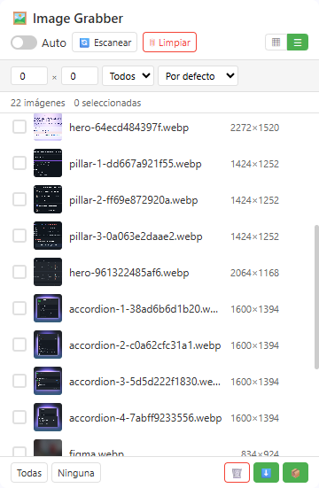

# Image Grabber

[English](../README.md) | [中文](README_zh.md) | Español | [Deutsch](README_de.md) | [日本語](README_ja.md) | [Français](README_fr.md)

**Image Grabber** es un descargador de imágenes gratuito para Chrome y Edge: escanea cualquier página web y descarga todas sus imágenes en lote con un clic.

> Basada en Chromium · Manifest V3 · Sin rastreo · Interfaz de panel lateral

---

## Funcionalidades

### Funcionalidades gratuitas

| Funcionalidad | Descripción |
|---------|-------------|
| 🔍 **Detección inteligente de imágenes** | Escanea `` (incluidos atributos `data-src` / de carga diferida), `srcset` (elige el candidato más grande), CSS `background-image` (en línea, `::before` y `::after`), `<video poster>`, `<source srcset>` e imágenes SVG `<image>` |
| 💎 **Detección de originales** | Encuentra originales de mayor resolución expuestos en la página (atributos `data-*` de carga diferida, enlaces de imagen principales, candidatos de `<picture>` / `srcset`) y comprueba sus dimensiones reales antes de usarlos; si no se verifica un original mayor, se usa la imagen mostrada. Se puede desactivar con el interruptor **Original** |
| 🤖 **Recopilación automática** | Recopila imágenes continuamente a medida que la página se carga (MutationObserver + idle callback) |
| 📋 **Vista de cuadrícula y lista** | Alterna entre miniaturas en cuadrícula y vista de tabla compacta |
| 🔎 **Filtrado y ordenación** | Filtra por dimensiones mínimas y tipo de imagen; ordena por ancho, alto o nombre de archivo |
| 🎯 **Selección manual** | Haz clic directamente sobre un elemento de la página para capturar su imagen |
| 🖼️ **Vista previa en lightbox** | Vista previa a tamaño completo con navegación por teclado (← → Esc), descarga y copia de URL |
| 🔗 **Copiar URLs** | Copia al portapapeles las URLs de las imágenes seleccionadas (o de todas las filtradas) |
| 📥 **Descarga por lotes (máx. 30 por lote)** | Cada imagen se obtiene dentro de la página de la extensión con las cookies y el `Referer` de la página, y se entrega al motor de descargas como blob — las imágenes con protección antienlace o restringidas a sesión iniciada se guardan como el archivo real, no como una página 403. Mantén el panel abierto hasta que termine el lote |
| 📊 **Informe de resultados** | Al terminar un lote, un aviso indica cuántos archivos se descargaron y cuántos fallaron |
| 💾 **Estado persistente** | Las listas de imágenes y tus marcas de «eliminado» sobreviven a las recargas de página y a los reinicios del service worker |
| 🔄 **Compatibilidad con SPA** | Detecta navegaciones reales y `pushState` / `replaceState` / `popstate`; las imágenes de la página anterior se borran y la nueva vista se re-escanea automáticamente |

### Funcionalidades Premium (requieren licencia)

| Funcionalidad | Descripción |
|---------|-------------|
| ⭐ **Selección ilimitada** | Sin límite de 30 imágenes — selecciona y descarga tantas como quieras |
| 🔬 **Deduplicación por pHash** | El hash perceptivo detecta imágenes duplicadas/similares aunque tengan URLs distintas |
| 🔄 **Conversión de formato** | Convierte al descargar a JPG, PNG o WebP. GIF, SVG, AVIF y otros formatos de origen se conservan tal cual en lugar de recodificarse con pérdida |
| 🗜️ **Compresión de imágenes** | Ajusta la calidad y el ancho máximo para reducir el tamaño del archivo. Con formato **Original** y sin redimensionar, se descargan los bytes originales sin tocar |
| 🚀 **Pipeline de descarga avanzada** | Pipeline con un clic: deduplicar → convertir/redimensionar (solo si se solicita) → descargar |

---

## Gratis vs Premium

| | Gratis | Premium |
|---|:---:|:---:|
| Escaneo y visualización de imágenes | ✅ Ilimitado | ✅ Ilimitado |
| Copiar URLs de imágenes | ✅ | ✅ |
| Límite de descarga por lotes | 30 imágenes por lote | Ilimitado |
| Descarga básica (formato original) | ✅ | ✅ |
| Descargas con antienlace / sesión | ✅ | ✅ |
| Deduplicación por pHash | — | ✅ |
| Conversión de formato (WebP→JPG/PNG) | — | ✅ |
| Compresión de imágenes | — | ✅ |
| Pipeline de descarga avanzada | — | ✅ |

---

## Vista previa

  

---

## Navegadores compatibles

| Navegador | Estado |
|---------|--------|
| Google Chrome | ✅ Totalmente compatible (Panel lateral) |
| Microsoft Edge | ✅ Totalmente compatible (Panel lateral) |
| Otros navegadores basados en Chromium | ✅ Compatible (alternativa con popup) |

---

## Interfaces

| Interfaz | Cómo se abre | Qué ofrece |
|---------|--------------|----------------|
| **Panel lateral** | Haz clic en el icono de la barra de herramientas (Chrome / Edge) | Interfaz completa, incluido el panel ⚙️ Configuración donde se introduce la clave de licencia, además de 🎯 **Selección manual** |
| **Popup** | Se abre automáticamente en navegadores sin la API de panel lateral, o si el panel lateral no puede abrirse | Navegación en cuadrícula/lista, filtros, selección y descargas |
| **Pestaña independiente** | Se abre automáticamente como alternativa cuando el panel lateral no puede usarse | Navegación en cuadrícula, filtros, selección y descargas |

---

## Instalación

| Tienda | Enlace |
|---|---|
| Chrome Web Store | [Instalar en Chrome](https://chromewebstore.google.com/detail/chahehfnmhgnekhnnlmnganffejjaocc) |
| Complementos de Microsoft Edge | [Instalar en Edge](https://microsoftedge.microsoft.com/addons/detail/peiilcogdklfmnlioikcmdkgmnlpobke) |

> Instale solo desde las tiendas oficiales de arriba; evite sitios de descarga de terceros.

---

## Uso

1. **Navega por cualquier página web** — El script de contenido recopila imágenes de la página actual
2. **Haz clic en el icono de Image Grabber** para abrir el panel lateral
3. **Activa Auto** — Alterna "Auto" para recopilar imágenes continuamente mientras la página se carga
4. **O haz clic en Escanear** — Lanza manualmente un escaneo completo de la página
5. **Filtra** — Establece ancho/alto mínimo, selecciona el tipo de imagen y elige el orden
6. **Cambia de vista** — Alterna entre cuadrícula (▦) y lista (☰)
7. **Selecciona** — Haz clic en las imágenes para seleccionar (hasta 30 para usuarios gratuitos)
8. **Vista previa** — Haz clic en cualquier imagen para abrir el lightbox
9. **Copia** — Usa el botón de copiar para poner las URLs de las imágenes seleccionadas en el portapapeles
10. **Descarga** — Haz clic en ⬇️ para la descarga básica, o ⭐ para la descarga avanzada (premium). Un aviso informa de cuántos archivos se descargaron y cuántos fallaron. Las descargas las realiza la página del panel, así que mantenlo abierto hasta que termine el lote

### Descarga avanzada (Premium)

1. Obtén tu clave de licencia en [annmax1983.com](https://www.annmax1983.com/checkout.html?plugin=imagegrabber)
2. Abre Configuración (⚙️ icono de engranaje) → introduce tu clave de licencia
3. Configura el formato de salida, la calidad y las opciones de deduplicación
4. Selecciona las imágenes y haz clic en el botón ⭐ Descarga avanzada
5. El pipeline hará: deduplicar (si está activado) → convertir/redimensionar (solo si elegiste un formato o un ancho máximo) → descargar

Los destinos de conversión se limitan a JPG, PNG y WebP. GIF, SVG, AVIF, BMP y otros formatos se descargan en su formato original (se informan como degradados si solicitaste conversión). Elegir **Original** sin ancho máximo descarga los bytes de origen sin recodificar, independientemente del control de calidad.

---

## Privacidad

- Permisos requeridos: `storage`, `downloads`, `sidePanel`, `declarativeNetRequest`
- Se requiere el permiso de host `<all_urls>` para detectar y descargar imágenes alojadas en cualquier dominio
- `declarativeNetRequest` se usa únicamente para establecer la cabecera `Referer`. La regla está activa mientras un panel muestra imágenes de una pestaña (para que las vistas previas carguen en sitios con protección antienlace) y durante un lote de descargas (para que el archivo guardado sea la imagen real, no un marcador de error). Se limita a los dominios de imagen que aparecen en pantalla y se retira al cerrar el panel, cambiar de pestaña o navegar.
- Mientras la regla está activa se aplica a las peticiones a esos dominios de imagen, no solo a las peticiones de la extensión: una petición de la página a ese mismo dominio durante un lote también llevará el `Referer` de la página. La regla es de sesión y por dominio; no reescribe cabeceras de forma permanente
- La navegación SPA se detecta localmente comparando `location.href`. No se lee, registra ni envía ningún historial de navegación
- La detección de originales sondea las URLs candidatas localmente con cargas de imagen temporales; esas peticiones van directamente al host de la imagen (el mismo host que ya sirve las imágenes de la página). Solo se leen dimensiones: no se sube ni se almacena contenido de imágenes, y los resultados verificados permanecen en el almacenamiento local. Se puede desactivar con el interruptor **Original**
- Todo el procesamiento de imágenes se ejecuta **localmente** en tu navegador — sin subida de datos externos
- Sin analíticas, sin rastreo de usuarios, ni recopilación remota de datos
- Los datos de imágenes se almacenan solo en el almacenamiento local de tu navegador
- La validación de licencia envía la clave de licencia, un identificador de instalación aleatorio y metadatos básicos del navegador; nunca tus imágenes, el contenido de las páginas ni el historial

---

## Aviso de derechos de autor

Esta extensión solo proporciona capacidades de visualización y descarga local de recursos de imagen para la organización personal sin conexión y referencia del usuario. Todas las imágenes, ilustraciones y materiales gráficos de las páginas web están protegidos por las leyes de derechos de autor y propiedad intelectual. Los usuarios no deberían utilizar las imágenes descargadas por lotes para producción comercial, reimpresión no autorizada, distribución secundaria, extracción masiva u otros comportamientos infractores. Toda responsabilidad civil y legal derivada del uso indebido recaerá exclusivamente sobre el usuario.

## Recordatorio sobre rastreo web

No uses esta herramienta para capturar masivamente recursos de imagen de sitios web con protección de derechos de autor, mecanismos anti-rastreo o restricciones claras de uso de contenido. Respeta las reglas de acceso del sitio web y las leyes locales al escanear imágenes de páginas.

---

## Aviso sobre el código fuente

Este repositorio contiene el código fuente completo de la extensión: el manifest, los scripts de contenido, el service worker, todas las interfaces, los archivos de idioma y el script de build. La extensión también se distribuye a través de Chrome Web Store.

---

## Licencia

Copyright © 2026 Image Grabber. Todos los derechos reservados.

---

> **Nota:** El código fuente se incluye en este repositorio por transparencia.

---

## ❤️ Apoya al desarrollador

Si Image Grabber te resulta útil, ¡invítame a un café!

**[👉 Haz clic aquí para apoyar](https://ko-fi.com/annmax?ref=imagegrabber)**
