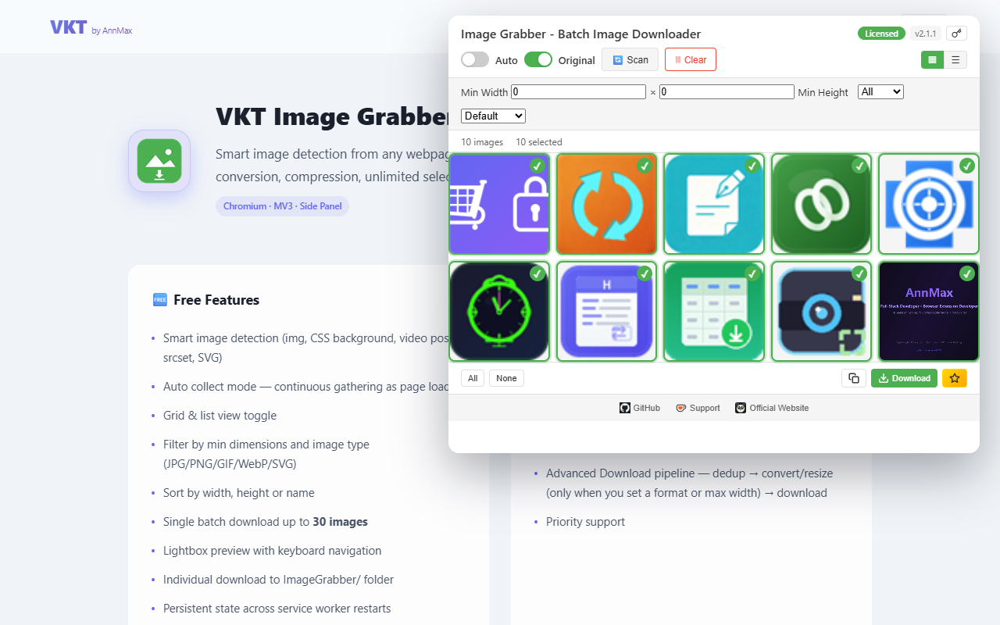

# Image Grabber

[English](../README.md) | [中文](README_zh.md) | [Español](README_es.md) | [Deutsch](README_de.md) | [日本語](README_ja.md) | Français

**Image Grabber** est un téléchargeur d’images gratuit pour Chrome et Edge : scannez n’importe quelle page web et téléchargez toutes ses images en lot en un clic.

> Chrome / Edge / Firefox · Manifest V3 · Aucun suivi · Panneau latéral / Popup

---

## Fonctionnalités

### Fonctionnalités gratuites

| Fonctionnalité | Description |
|---------|-------------|
| 🔍 **Détection intelligente** | Analyse `` (dont `data-src` / chargement différé), `srcset` (le plus grand candidat), CSS `background-image` (en ligne, `::before` et `::after`), `<video poster>`, `<source srcset>`, SVG `<image>`, ainsi que les images dans les **iframes** et les **shadow roots ouverts** |
| 💎 **Détection des originaux** | Repère les originaux haute résolution exposés dans la page (attributs `data-*` de chargement différé, liens d'image parents, candidats `<picture>` / `srcset`) et vérifie leurs dimensions réelles avant utilisation ; à défaut d'original plus grand confirmé, l'image affichée est utilisée. Désactivable via l'interrupteur **Original** |
| 🤖 **Collecte automatique** | Collecte en continu les images pendant le chargement de la page (MutationObserver + idle callback) |
| 🔃 **Défilement automatique** | Interrupteur **Défiler** facultatif : avant l'analyse, fait défiler la page (et chaque iframe) vers le bas pour charger les images en chargement différé, puis analyse. S'arrête quand la page cesse de grandir, après 40 étapes ou 60 secondes, ou dès que vous faites défiler, balayez ou appuyez sur une touche de pagination. Désactivé par défaut |
| 📋 **Vue grille et liste** | Basculez entre la grille de miniatures et la vue tableau compacte |
| 🔎 **Filtrage et tri** | Filtrez par dimensions minimales et type d'image ; triez par largeur, hauteur ou nom de fichier |
| 🎯 **Sélection manuelle** | Cliquez directement sur un élément de la page pour capturer son image |
| 🖱️ **Entrée par clic droit** | Clic droit sur la page → **Récupérer les images de cette page** pour ouvrir le panneau et analyser immédiatement l'onglet courant, sans chercher d'abord l'icône de la barre d'outils |
| 🖼️ **Prévisualisation plein écran** | Aperçu en taille réelle avec navigation clavier (← → Esc), téléchargement et copie d'URL |
| 🔗 **Copier les URLs** | Copie dans le presse-papiers les URLs des images sélectionnées (ou de toutes celles filtrées) |
| 📥 **Téléchargement par lot (30 max par lot)** | Chaque image est récupérée dans la page de l'extension avec les cookies et le `Referer` de la page, puis transmise au moteur de téléchargement sous forme de blob — les images protégées contre le hotlink ou réservées à une session connectée sont enregistrées comme le vrai fichier, pas comme une page 403. Gardez le panneau ouvert jusqu'à la fin du lot |
| 📦 **Téléchargement ZIP** | Regroupe le lot en cours dans un seul `.zip` — pratique pour les galeries, avec la même récupération anti-hotlink qu'un lot normal. Les lots très volumineux sont automatiquement découpés en parties numérotées (300 fichiers ou 300 Mo par partie). Gratuit, dans la limite de 30 images |
| 📊 **Rapport de résultat** | À la fin d'un lot, une notification indique combien de fichiers ont réussi et combien ont échoué |
| 💾 **Persistance des données** | Les listes d'images et vos marques « supprimé » survivent aux rechargements de page et aux redémarrages du service worker |
| 🔄 **Support SPA** | Détecte les navigations réelles et `pushState` / `replaceState` / `popstate` ; les images de la page précédente sont effacées et la nouvelle vue est ré-analysée automatiquement |

### Fonctionnalités Premium (licence requise)

| Fonctionnalité | Description |
|---------|-------------|
| ⭐ **Sélection illimitée** | Pas de limite de 30 images — sélectionnez et téléchargez autant que vous voulez |
| 🔬 **Dédoublonnage pHash** | Le hash perceptuel détecte les images en double/similaires même à partir d'URLs différentes |
| 🔄 **Conversion de format** | Convertissez au téléchargement en JPG, PNG ou WebP. Les formats sources GIF, SVG, AVIF et autres sont conservés tels quels au lieu d'être réencodés avec perte |
| 🗜️ **Compression d'images** | Ajustez la qualité et la largeur maximale pour réduire la taille des fichiers. Avec le format **Original** et sans redimensionnement, les octets d'origine sont téléchargés sans modification |
| 🚀 **Pipeline de téléchargement avancé** | Pipeline en un clic : dédoublonnage → conversion/redimensionnement (uniquement sur demande) → téléchargement |

---

## Gratuit vs Premium

| | Gratuit | Premium |
|---|:---:|:---:|
| Analyse et parcours des images | ✅ Illimité | ✅ Illimité |
| Copie des URLs d'images | ✅ | ✅ |
| Limite de téléchargement par lot | 30 images par lot | Illimité |
| Téléchargement de base (format original) | ✅ | ✅ |
| ZIP du lot en cours | ✅ | ✅ |
| Téléchargements hotlink / session connectée | ✅ | ✅ |
| Dédoublonnage pHash | — | ✅ |
| Conversion de format (WebP→JPG/PNG) | — | ✅ |
| Compression d'images | — | ✅ |
| Pipeline de téléchargement avancé | — | ✅ |

---

## Aperçu

  

---

## Navigateurs compatibles

| Navigateur | Statut |
|---------|--------|
| Google Chrome | ✅ Entièrement pris en charge (Panneau latéral) |
| Microsoft Edge | ✅ Entièrement pris en charge (Panneau latéral) |
| Mozilla Firefox | ✅ Entièrement pris en charge |
| Autres navigateurs basés sur Chromium | ✅ Pris en charge (repli sur popup) |

> **Note Firefox :** Firefox n’a pas d’API de panneau latéral, l’extension s’ouvre donc en **popup de la barre d’outils**. Ce popup contient toute l’interface de travail (vue grille/liste, filtres, sélection, téléchargements et saisie de la clé de licence) et peut aussi s’ouvrir dans un onglet détaché pour les lots plus importants. Seule exception : **🎯 Manual Pick**, qui fait partie du panneau latéral de Chrome / Edge et n’est donc pas proposé dans la version Firefox. La version Firefox ne demande pas la permission `sidePanel`. Laissez le popup ou l’onglet ouvert pendant un téléchargement par lot, car les téléchargements sont lancés depuis cette page.

---

## Interfaces

| Interface | Ouverture | Ce qu'elle offre |
|---------|--------------|----------------|
| **Panneau latéral** | Clic sur l'icône de la barre d'outils (Chrome / Edge) | Interface complète, y compris le panneau ⚙️ Paramètres où saisir la clé de licence, plus la 🎯 **Sélection manuelle** |
| **Popup** | S'ouvre automatiquement sur les navigateurs sans API de panneau latéral, ou si le panneau latéral ne peut pas s'ouvrir | Navigation en grille/liste, filtres, sélection et téléchargements |
| **Onglet détaché** | S'ouvre automatiquement en repli lorsque le panneau latéral est indisponible | Navigation en grille, filtres, sélection et téléchargements |

---

## Installation

| Store | Lien |
|---|---|
| Chrome Web Store | [Installer dans Chrome](https://chromewebstore.google.com/detail/chahehfnmhgnekhnnlmnganffejjaocc) |
| Microsoft Edge Add-ons | [Installer dans Edge](https://microsoftedge.microsoft.com/addons/detail/peiilcogdklfmnlioikcmdkgmnlpobke) |
| Modules complémentaires Firefox (AMO) | [Installer pour Firefox](https://addons.mozilla.org/firefox/addon/vkt-image-grabber/) |

> Installez uniquement depuis les boutiques officielles ci-dessus — évitez les sites de téléchargement tiers.

---

## Utilisation

1. **Parcourez n'importe quelle page web** — Le script de contenu collecte les images de la page courante
2. **Ouvrez le panneau** — Cliquez sur l'icône Image Grabber pour ouvrir le panneau latéral, ou faites un clic droit sur la page → **Récupérer les images de cette page**
3. **Activez l'auto** — Basculez sur « Auto » pour collecter en continu les images pendant le chargement de la page
4. **Ou cliquez sur Scanner** — Déclenchez manuellement un scan complet de la page. Avec **Défiler** activé, la page défile d'abord vers le bas pour charger les images en chargement différé, puis elle est analysée
5. **Filtrez** — Définissez une largeur/hauteur minimale, sélectionnez le type d'image, choisissez l'ordre de tri
6. **Changez de vue** — Basculez entre la grille (▦) et la liste (☰)
7. **Sélectionnez** — Cliquez sur les images pour les sélectionner (30 max pour les utilisateurs gratuits)
8. **Prévisualisez** — Cliquez sur une image pour ouvrir l'aperçu plein écran
9. **Copiez** — Utilisez le bouton copier pour placer les URLs des images sélectionnées dans le presse-papiers
10. **Téléchargez** — Cliquez sur ⬇️ pour le téléchargement de base, sur 📦 pour enregistrer le lot en ZIP, ou sur ⭐ pour le téléchargement avancé (Premium). Une notification indique combien de fichiers ont été téléchargés et combien ont échoué. Les téléchargements sont effectués par la page du panneau ; gardez-la ouverte jusqu'à la fin du lot. Les gros lots du téléchargement avancé sont automatiquement découpés en parties ZIP numérotées

### Téléchargement avancé (Premium)

1. Obtenez votre clé de licence sur [annmax1983.com](https://annmax1983.com/checkout?plugin=imagegrabber)
2. Ouvrez les Paramètres (⚙️ icône engrenage) → saisissez votre clé de licence
3. Configurez le format de sortie, la qualité et les options de dédoublonnage
4. Sélectionnez les images et cliquez sur le bouton ⭐ Téléchargement avancé
5. Le pipeline va : dédoublonner (si activé) → convertir/redimensionner (uniquement si un format ou une largeur max est choisi) → télécharger

Les cibles de conversion sont limitées à JPG, PNG et WebP. GIF, SVG, AVIF, BMP et autres formats sont téléchargés dans leur format d'origine (signalés comme dégradés si vous avez demandé une conversion). Choisir **Original** sans largeur maximale télécharge les octets source sans réencodage, quel que soit le curseur de qualité.

---

## Confidentialité

- Permissions requises : `storage`, `downloads`, `declarativeNetRequest` et `contextMenus` (`sidePanel` uniquement sous Chrome / Edge ; Firefox ne la demande pas et utilise un popup de la barre d’outils)
- `contextMenus` ne sert qu'à ajouter l'entrée du menu contextuel ; aucun contenu de page n'est lu par ce biais
- La permission d'hôte `<all_urls>` est nécessaire pour détecter et télécharger les images hébergées sur n'importe quel domaine
- `declarativeNetRequest` sert uniquement à définir l'en-tête `Referer`. La règle est active tant qu'un panneau affiche les images d'un onglet (pour que les aperçus se chargent sur les sites protégés contre le hotlink) et pendant un lot de téléchargements (pour que le fichier enregistré soit la vraie image, pas une image d'erreur). Elle est limitée aux domaines d'images actuellement affichés et retirée à la fermeture du panneau, au changement d'onglet ou lors d'une navigation.
- Tant que la règle est active, elle s'applique aux requêtes vers ces domaines d'images, pas seulement aux requêtes de l'extension : une requête de la page vers le même domaine d'image pendant un lot portera aussi le `Referer` de la page. La règle est limitée à la session et au domaine ; elle ne réécrit pas les en-têtes de façon permanente
- La navigation SPA est détectée localement en comparant `location.href`. Aucun historique de navigation n'est lu, enregistré ou transmis
- La détection des originaux sonde localement les URLs candidates avec des chargements d'image temporaires ; ces requêtes vont directement à l'hôte des images (le même hôte qui sert déjà les images de la page). Seules les dimensions sont lues — aucun contenu d'image n'est envoyé ni stocké, et les résultats vérifiés restent dans le stockage local. Désactivable via l'interrupteur **Original**
- Tout le traitement des images se fait **en local** dans votre navigateur — aucun envoi de données externes
- Pas d'analytics, pas de suivi utilisateur, pas de collecte de données distantes
- Les données images sont stockées uniquement dans le stockage local de votre navigateur
- La validation de licence envoie la clé de licence, un identifiant d'installation aléatoire et des métadonnées de navigateur de base — jamais vos images, le contenu des pages ni l'historique

---

## Avertissement relatif au droit d'auteur

Cette extension fournit uniquement une fonction de visualisation et de téléchargement local de ressources images pour le tri personnel et la consultation hors ligne des utilisateurs. Toutes les images, illustrations et ressources graphiques des pages web sont protégées par le droit d'auteur et les lois sur la propriété intellectuelle. Les utilisateurs ne doivent pas utiliser les images téléchargées par lot à des fins de production commerciale, de republication non autorisée, de redistribution secondaire, d'extraction massive ou de toute autre activité contrefaisante. Toute responsabilité civile et juridique découlant d'une utilisation inappropriée incombe exclusivement à l'utilisateur.

## Rappel sur l'extraction

N'utilisez pas cet outil pour extraire massivement des ressources images de sites disposant de protections par droit d'auteur, de mécanismes anti-scraping ou de restrictions claires sur l'utilisation des contenus. Veuillez respecter les règles d'accès des sites et les lois locales lors de l'analyse des images de page.

---

## Avis sur le code source

> ⚠️ **Ce dépôt sert uniquement à la présentation du projet — le code source complet n'y est pas publié.** Il ne contient que la documentation d'utilisation, les notes de version et les informations d'assistance de l'extension.

> 📥 **Téléchargement et installation uniquement depuis les boutiques officielles :** Chrome Web Store · Microsoft Edge Add-ons · Modules complémentaires Firefox (AMO). Aucun installateur hors ligne n'est distribué ici.

---

## Licence

Copyright © 2026 Image Grabber. Tous droits réservés.

Ce logiciel est propriétaire et à code fermé. Sans autorisation écrite préalable de l'auteur, la décompilation, l'ingénierie inverse, le crackage, la modification, le reconditionnement, la redistribution ou la revente du logiciel (en tout ou en partie) sont strictement interdites.

---

## ❤️ Soutenir le développeur

Si Image Grabber vous est utile, offrez-moi un café !

**[👉 Cliquez ici pour soutenir](https://ko-fi.com/annmax?ref=imagegrabber)**

---

## Liens

- **Site officiel:** https://annmax1983.com/
- **Cette extension:** https://annmax1983.com/extensions/imagegrabber
- **Confidentialité:** https://annmax1983.com/privacy
- **Contact:** support@annmax1983.com
