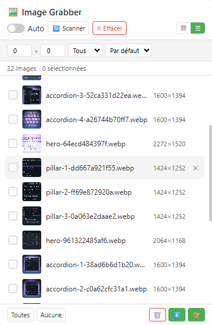

# Image Grabber

[English](../README.md) | [中文](README_zh.md) | [Español](README_es.md) | [Deutsch](README_de.md) | [日本語](README_ja.md) | Français

**Image Grabber** est un téléchargeur d’images gratuit pour Chrome et Edge : scannez n’importe quelle page web et téléchargez toutes ses images en lot en un clic.

> Chromium · Manifest V3 · Aucun suivi · Panneau latéral

---

## Fonctionnalités

### Fonctionnalités gratuites

| Fonctionnalité | Description |
|---------|-------------|
| 🔍 **Détection intelligente des images** | Analyse les `` (y compris les attributs `data-src` / de chargement différé), `srcset` (choisit le plus grand candidat), CSS `background-image` (en ligne, `::before` et `::after`), `<video poster>`, `<source srcset>` et les images SVG `<image>` |
| 🤖 **Collecte automatique** | Collecte en continu les images pendant le chargement de la page (MutationObserver + idle callback) |
| 📋 **Vue grille et liste** | Basculez entre la grille de miniatures et la vue tableau compacte |
| 🔎 **Filtrage et tri** | Filtrez par dimensions minimales et type d'image ; triez par largeur, hauteur ou nom de fichier |
| 🎯 **Sélection manuelle** | Cliquez directement sur un élément de la page pour capturer son image |
| 🖼️ **Prévisualisation plein écran** | Aperçu en taille réelle avec navigation clavier (← → Esc), téléchargement et copie d'URL |
| 🔗 **Copier les URLs** | Copie dans le presse-papiers les URLs des images sélectionnées (ou de toutes celles filtrées) |
| 📥 **Téléchargement par lot (30 max par lot)** | Les téléchargements passent par le moteur de téléchargement du navigateur : les cookies de session, l'User-Agent et le Referer sont donc gérés automatiquement — les images protégées contre le hotlink ou réservées à une session connectée sont bien enregistrées |
| 📊 **Rapport de résultat** | À la fin d'un lot, une notification indique combien de fichiers ont réussi et combien ont échoué |
| 💾 **Persistance des données** | Les listes d'images et vos marques « supprimé » survivent aux rechargements de page et aux redémarrages du service worker |
| 🔄 **Support SPA** | Re-scan automatique lors de la navigation SPA (`pushState` / `replaceState` / `popstate`) |

### Fonctionnalités Premium (licence requise)

| Fonctionnalité | Description |
|---------|-------------|
| ⭐ **Sélection illimitée** | Pas de limite de 30 images — sélectionnez et téléchargez autant que vous voulez |
| 🔬 **Dédoublonnage pHash** | Le hash perceptuel détecte les images en double/similaires même à partir d'URLs différentes |
| 🔄 **Conversion de format** | Convertissez au téléchargement : WebP → JPG, PNG ou tout format supporté |
| 🗜️ **Compression d'images** | Ajustez la qualité et la largeur maximale pour réduire la taille des fichiers |
| 🚀 **Pipeline de téléchargement avancé** | Pipeline en un clic : dédoublonnage → conversion → compression → téléchargement |

---

### Nouveautés de la version 2.0.7

- **Nom et description pensés pour la recherche** — le nom contient désormais le mot-clé exact *Image Downloader* et la description commence par les termes réellement recherchés (dans les 6 langues).
- **SEO de la documentation et du site** — première ligne du README et métadonnées de la page officielle (description, carte de partage) réécrites.

### Nouveautés de la version 2.0.6

- **Les téléchargements protégés sont désormais réellement enregistrés** — les requêtes d'image du panneau transmettent le `Referer` de la page via une règle `declarativeNetRequest` à portée de session, mais le moteur de téléchargement du navigateur ne le fait pas : sur les sites protégés contre le hotlink, un téléchargement pouvait donc signaler un succès alors que le fichier enregistré n'était qu'une page d'erreur 403. L'image est maintenant récupérée à l'intérieur du panneau de l'extension (avec les cookies et le `Referer` de la page), puis transmise au moteur de téléchargement sous forme de blob, de sorte que les images protégées et celles visibles uniquement après connexion soient enregistrées comme la vraie image.
- **Décompte honnête des réussites et des échecs** — la notification de fin attend désormais que chaque téléchargement soit réellement terminé et indique les chiffres réels, au lieu de compter ceux qui ont simplement été lancés.
- **Téléchargement avancé corrigé sur les sites protégés** — la chaîne dédupliquer → convertir → compresser ne parvenait pas à charger dans un canvas les images protégées contre le hotlink. Chaque image est désormais lue via la même requête authentifiée, de sorte que la déduplication pHash et la conversion de format fonctionnent à nouveau ; un fichier qui ne peut pas être réencodé est téléchargé dans sa version d'origine au lieu d'être abandonné.

---

## Gratuit vs Premium

| | Gratuit | Premium |
|---|:---:|:---:|
| Analyse et parcours des images | ✅ Illimité | ✅ Illimité |
| Copie des URLs d'images | ✅ | ✅ |
| Limite de téléchargement par lot | 30 images par lot | Illimité |
| Téléchargement de base (format original) | ✅ | ✅ |
| Téléchargements hotlink / session connectée | ✅ | ✅ |
| Dédoublonnage pHash | — | ✅ |
| Conversion de format (WebP→JPG/PNG) | — | ✅ |
| Compression d'images | — | ✅ |
| Pipeline de téléchargement avancé | — | ✅ |

---

## Aperçu

  

---

## Navigateurs compatibles

| Navigateur | Statut |
|---------|--------|
| Google Chrome | ✅ Entièrement pris en charge (Panneau latéral) |
| Microsoft Edge | ✅ Entièrement pris en charge (Panneau latéral) |
| Autres navigateurs basés sur Chromium | ✅ Pris en charge (repli sur popup) |

---

## Interfaces

| Interface | Ouverture | Ce qu'elle offre |
|---------|--------------|----------------|
| **Panneau latéral** | Clic sur l'icône de la barre d'outils (Chrome / Edge) | Interface complète, y compris le panneau ⚙️ Paramètres où saisir la clé de licence, plus la 🎯 **Sélection manuelle** |
| **Popup** | S'ouvre automatiquement sur les navigateurs sans API de panneau latéral, ou si le panneau latéral ne peut pas s'ouvrir | Navigation en grille/liste, filtres, sélection et téléchargements |
| **Onglet détaché** | S'ouvre automatiquement en repli lorsque le panneau latéral est indisponible | Navigation en grille, filtres, sélection et téléchargements |

---

## Installation

1. Ouvrez la page des extensions de votre navigateur :
   - **Chrome** : `chrome://extensions/`
   - **Edge** : `edge://extensions/`
2. Activez le **mode Développeur** (bouton en haut à droite)
3. Cliquez sur **Charger le package décompressé** et sélectionnez le dossier du projet
4. Cliquez sur l'icône Image Grabber dans votre barre d'outils pour ouvrir le panneau latéral

---

## Utilisation

1. **Parcourez n'importe quelle page web** — Le script de contenu collecte les images de la page courante
2. **Cliquez sur l'icône Image Grabber** pour ouvrir le panneau latéral
3. **Activez l'auto** — Basculez sur « Auto » pour collecter en continu les images pendant le chargement de la page
4. **Ou cliquez sur Scanner** — Déclenchez manuellement un scan complet de la page
5. **Filtrez** — Définissez une largeur/hauteur minimale, sélectionnez le type d'image, choisissez l'ordre de tri
6. **Changez de vue** — Basculez entre la grille (▦) et la liste (☰)
7. **Sélectionnez** — Cliquez sur les images pour les sélectionner (30 max pour les utilisateurs gratuits)
8. **Prévisualisez** — Cliquez sur une image pour ouvrir l'aperçu plein écran
9. **Copiez** — Utilisez le bouton copier pour placer les URLs des images sélectionnées dans le presse-papiers
10. **Téléchargez** — Cliquez sur ⬇️ pour le téléchargement de base, ou ⭐ pour le téléchargement avancé (Premium). Une notification indique combien de fichiers ont été téléchargés et combien ont échoué

### Téléchargement avancé (Premium)

1. Obtenez votre clé de licence sur [annmax1983.com](https://www.annmax1983.com/checkout.html?plugin=imagegrabber)
2. Ouvrez les Paramètres (⚙️ icône engrenage) → saisissez votre clé de licence
3. Configurez le format de sortie, la qualité et les options de dédoublonnage
4. Sélectionnez les images et cliquez sur le bouton ⭐ Téléchargement avancé
5. Le pipeline va : dédoublonner (si activé) → convertir le format → compresser → télécharger

---

## Confidentialité

- Permissions requises : `storage`, `downloads`, `sidePanel`, `declarativeNetRequest`
- La permission d'hôte `<all_urls>` est nécessaire pour détecter et télécharger les images hébergées sur n'importe quel domaine
- `declarativeNetRequest` sert uniquement à définir l'en-tête `Referer`. La règle est active tant qu'un panneau affiche les images d'un onglet (pour que les aperçus se chargent sur les sites protégés contre le hotlink) et pendant un lot de téléchargements (pour que le fichier enregistré soit la vraie image, pas une image d'erreur). Elle est limitée aux domaines d'images actuellement affichés et retirée à la fermeture du panneau, au changement d'onglet ou lors d'une navigation.
- Tout le traitement des images se fait **en local** dans votre navigateur — aucun envoi de données externes
- Pas d'analytics, pas de suivi utilisateur, pas de collecte de données distantes
- Les données images sont stockées uniquement dans le stockage local de votre navigateur
- La validation de licence envoie la clé de licence, un identifiant d'installation aléatoire et des métadonnées de navigateur de base — jamais vos images, le contenu des pages ni l'historique

---

## Avertissement relatif au droit d'auteur

Cette extension fournit uniquement une fonction de visualisation et de téléchargement local de ressources images pour le tri personnel et la consultation hors ligne des utilisateurs. Toutes les images, illustrations et ressources graphiques des pages web sont protégées par le droit d'auteur et les lois sur la propriété intellectuelle. Les utilisateurs ne doivent pas utiliser les images téléchargées par lot à des fins de production commerciale, de republication non autorisée, de redistribution secondaire, d'extraction massive ou de toute autre activité contrefaisante. Toute responsabilité civile et juridique découlant d'une utilisation inappropriée incombe exclusivement à l'utilisateur.

## Rappel sur l'extraction

N'utilisez pas cet outil pour extraire massivement des ressources images de sites disposant de protections par droit d'auteur, de mécanismes anti-scraping ou de restrictions claires sur l'utilisation des contenus. Veuillez respecter les règles d'accès des sites et les lois locales lors de l'analyse des images de page.

---

## Avis sur le code source

> ⚠️ **Ce dépôt ne publie pas le code source.** Il contient uniquement la documentation d'utilisation, les notes de version et les ressources d'assistance. L'extension est distribuée exclusivement via le Chrome Web Store. Aucun package d'installation hors ligne ni code source destiné aux utilisateurs finaux n'est fourni.

---

## Licence

Copyright © 2026 Image Grabber. Tous droits réservés.

---

> **Note :** Ce dépôt est destiné à la **présentation du projet uniquement**. Il ne contient pas le code source complet, le manifest, les icônes ou les scripts de build. Le code source complet ne sera **pas** publié ici.

---

## ❤️ Soutenir le développeur

Si Image Grabber vous est utile, offrez-moi un café !

**[👉 Cliquez ici pour soutenir](https://ko-fi.com/annmax?ref=imagegrabber)**
