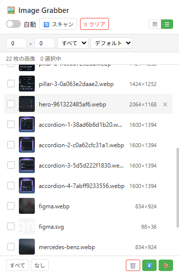

# Image Grabber

[English](../README.md) | [中文](README_zh.md) | [Español](README_es.md) | [Deutsch](README_de.md) | 日本語 | [Français](README_fr.md)

**Image Grabber** は Chrome / Edge 向けの無料画像ダウンローダー拡張機能です。Web ページをスキャンし、ワンクリックで画像を一括ダウンロードできます。

> Chromium系ブラウザ対応 · Manifest V3 · トラッキングなし · サイドパネルUI

---

## 機能一覧

### 無料機能

| 機能 | 説明 |
|---------|-------------|
| 🔍 **スマート画像検出** | ``（`data-src` / 遅延読み込み属性を含む）、`srcset`（最大の候補を採用）、CSS `background-image`（インライン、`::before`、`::after`）、`<video poster>`、`<source srcset>`、SVG `<image>`をスキャン |
| 🤖 **自動収集** | ページ読み込み中に画像を継続的に収集（MutationObserver＋idle callback） |
| 📋 **グリッド＆リスト表示** | サムネイルグリッドとコンパクトテーブル表示を切り替え |
| 🔎 **フィルター＆ソート** | 最小寸法と画像タイプでフィルタリング、幅・高さ・ファイル名でソート |
| 🎯 **手動ピック** | ページ上の要素を直接クリックしてその画像を取得 |
| 🖼️ **ライトボックスプレビュー** | キーボードナビゲーション対応のフルサイズプレビュー（← → Esc）、ダウンロードとURLコピー |
| 🔗 **URLをコピー** | 選択した画像（または現在のフィルター結果すべて）のURLをクリップボードにコピー |
| 📥 **バッチダウンロード（1回最大30枚）** | ダウンロードはブラウザ標準のダウンロードエンジン経由のため、Cookie・User-Agent・Refererが自動的に付与されます — 直リンク保護やログイン必須の画像も正しく保存されます |
| 📊 **ダウンロード結果レポート** | バッチ終了時に、成功した件数と失敗した件数をトーストで通知 |
| 💾 **状態永続化** | 画像リストと「削除済み」マークがページ再読み込みやService Worker再起動後も保持されます |
| 🔄 **SPA対応** | SPAナビゲーション時に自動再スキャン（`pushState` / `replaceState` / `popstate`） |

### Premium機能（ライセンス必要）

| 機能 | 説明 |
|---------|-------------|
| ⭐ **無制限の選択** | 30枚制限なし — 任意の数を選択・ダウンロード |
| 🔬 **pHash重複排除** | 知覚ハッシュで異なるURLの重複・類似画像を検出 |
| 🔄 **フォーマット変換** | ダウンロード時に変換：WebP → JPG、PNG、または対応フォーマット |
| 🗜️ **画像圧縮** | 品質と最大幅を調整してファイルサイズを削減 |
| 🚀 **高度なダウンロードパイプライン** | ワンクリックパイプライン：重複排除 → 変換 → 圧縮 → ダウンロード |

---

### 2.0.7 の新機能

- **検索を意識した名称と説明** — 拡張機能名に検索キーワード *Image Downloader* を含め、説明文も実際に検索される語を先頭に配置（6 言語すべて）。
- **ドキュメントと公式サイトの SEO 補強** — README の冒頭文と製品ページのメタ情報（説明・共有カード）を刷新。

### 2.0.6 の新機能

- **保護された画像が実際に保存されるようになりました** — パネルからの画像リクエストにはセッション単位の`declarativeNetRequest`ルールでページの`Referer`が付与されますが、ブラウザのダウンロードエンジンには付与されません。そのため直リンク保護されたサイトでは、ダウンロードが成功と表示されても保存されたファイルが403エラーページだけ、ということが起こり得ました。現在は拡張機能のパネル内で画像を取得し（ページのCookieと`Referer`を使用）、blobとしてダウンロードエンジンに渡すため、保護された画像やログイン後のみ表示される画像も本来の画像として保存されます。
- **正確な成功／失敗件数の報告** — 完了時の通知は、各ダウンロードが実際に終了するまで待ってから本当の件数を報告するようになり、「開始しただけ」のものを完了として数えなくなりました。
- **直リンク保護されたサイトで高度なダウンロードが動作** — 重複排除 → 形式変換 → 圧縮のパイプラインは、直リンク保護された画像をcanvasに読み込めませんでした。現在は各画像を同じ認証済みフェッチで取得するため、pHashによる重複排除と形式変換が機能します。再エンコードできないファイルは破棄されず、元の画像をダウンロードします。

---

## 無料版 vs Premium

| | 無料版 | Premium |
|---|:---:|:---:|
| 画像スキャン＆閲覧 | ✅ 無制限 | ✅ 無制限 |
| 画像URLのコピー | ✅ | ✅ |
| バッチダウンロード制限 | 1バッチあたり30枚 | 無制限 |
| 基本ダウンロード（元フォーマット） | ✅ | ✅ |
| 直リンク保護／ログイン必須のダウンロード | ✅ | ✅ |
| pHash重複排除 | — | ✅ |
| フォーマット変換（WebP→JPG/PNG） | — | ✅ |
| 画像圧縮 | — | ✅ |
| 高度なダウンロードパイプライン | — | ✅ |

---

## プレビュー

  

---

## 対応ブラウザ

| ブラウザ | ステータス |
|---------|--------|
| Google Chrome | ✅ 完全対応（サイドパネル） |
| Microsoft Edge | ✅ 完全対応（サイドパネル） |
| その他のChromium系ブラウザ | ✅ 対応（ポップアップフォールバック） |

---

## UI一覧

| UI | 開き方 | できること |
|---------|--------------|----------------|
| **サイドパネル** | ツールバーのアイコンをクリック（Chrome / Edge） | 完全なUI。ライセンスキーを入力する⚙️設定パネルを含む。さらに 🎯 **手動ピック** も利用可能 |
| **ポップアップ** | サイドパネルAPIのないブラウザ、またはサイドパネルを開けない場合に自動で開く | グリッド／リスト表示、フィルター、選択、ダウンロード |
| **独立タブ** | サイドパネルが使えない場合のフォールバックとして自動で開く | グリッド表示、フィルター、選択、ダウンロード |

---

## インストール

1. ブラウザの拡張機能ページを開きます：
   - **Chrome**: `chrome://extensions/`
   - **Edge**: `edge://extensions/`
2. **デベロッパーモード**を有効にします（右上のトグル）
3. **パッケージ化されていない拡張機能を読み込む**をクリックし、プロジェクトフォルダを選択します
4. ツールバーのImage Grabberアイコンをクリックしてサイドパネルを開きます

---

## 使い方

1. **任意のWebページを閲覧** — コンテンツスクリプトが現在のページから画像を収集します
2. **Image Grabberアイコンをクリック**してサイドパネルを開きます
3. **自動を有効化** — 「自動」トグルでページ読み込み中に画像を継続的に収集します
4. **またはスキャンをクリック** — 手動でページ全体のスキャンを実行します
5. **フィルター** — 最小幅/高さを設定し、画像タイプと並び順を選択します
6. **表示切替** — グリッド（▦）とリスト（☰）レイアウトを切り替えます
7. **選択** — 画像をクリックして選択（無料ユーザーは最大30枚）
8. **プレビュー** — 任意の画像をクリックしてライトボックスを開きます
9. **コピー** — コピーボタンで選択した画像のURLをクリップボードに入れます
10. **ダウンロード** — ⬇️で基本ダウンロード、⭐で高度なダウンロード（Premium）。完了後、ダウンロードできた件数と失敗した件数がトーストで通知されます

### 高度なダウンロード（Premium）

1. [annmax1983.com](https://www.annmax1983.com/checkout.html?plugin=imagegrabber)からライセンスキーを取得します
2. 設定（⚙️歯車アイコン）を開き、ライセンスキーを入力します
3. 出力フォーマット、品質、重複排除オプションを設定します
4. 画像を選択し、⭐高度なダウンロードボタンをクリックします
5. パイプラインが実行されます：重複排除（有効な場合）→ フォーマット変換 → 圧縮 → ダウンロード

---

## プライバシー

- 必要な権限：`storage`、`downloads`、`sidePanel`、`declarativeNetRequest`
- 任意のドメインの画像を検出・ダウンロードするために、ホスト権限`<all_urls>`が必要です
- `declarativeNetRequest`は`Referer`ヘッダーの設定にのみ使用されます。パネルがタブの画像を表示している間（直リンク保護されたサイトでもプレビューが読み込めるように）、およびダウンロードバッチの間（保存されるファイルがエラーのプレースホルダーではなく本来の実画像になるように）ルールが有効です。ルールは画面に表示されている画像のドメインに限定され、パネルを閉じる・タブを切り替える・ページが遷移した時点で削除されます
- すべての画像処理はブラウザ内で**ローカル**に実行されます — 外部データアップロードなし
- アナリティクス、ユーザートラッキング、リモートデータ収集はありません
- 画像データはブラウザのローカルストレージにのみ保存されます
- ライセンス検証で送信されるのはライセンスキー、ランダムなインストール識別子、基本的なブラウザーメタデータのみです（画像・ページ内容・閲覧履歴は送信されません）

---

## 著作権に関する免責事項

この拡張機能は、ユーザーの個人的なオフライン整理・参考用に、ローカル画像リソースの閲覧・ダウンロード機能を提供するだけです。Webページ上のすべての画像、イラスト、グラフィック素材は著作権および知的財産法で保護されています。ユーザーはバッチダウンロードした画像を商業生産、無断転載、二次配布、大量クロールその他の侵害行為に使用してはなりません。不適切な使用により生じたすべての民事的・法的責任は、ユーザーが単独で負うものとします。

## クローリングに関する注意

著作権保護、アンチクロールメカニズム、明確なコンテンツ利用制限のあるWebサイトから、このツールを使用して画像リソースをバッチキャプチャしないでください。ページ画像のスキャン時には、Webサイトのアクセス規則と現地の法律に従ってください。

---

## ソースコードに関する注意

> ⚠️ **このリポジトリにはソースコードは公開されていません。** 使用ドキュメント、リリースノート、サポートリソースのみを含みます。拡張機能はChrome Web Storeを通じてのみ配布されます。オフラインインストールパッケージやエンドユーザー向けソースコードは提供されません。

---

## ライセンス

Copyright © 2026 Image Grabber. All rights reserved.

---

> **注意：** このリポジトリは**プロジェクトの紹介**のみを目的としています。完全なソースコード、マニフェスト、アイコン、ビルドスクリプトは含まれていません。完全なソースコードはここでは**公開されません**。

---

## ❤️ 開発者を支援する

Image Grabberが役に立った場合は、コーヒーをおごってあげてください！

**[👉 こちらから支援する](https://ko-fi.com/annmax?ref=imagegrabber)**
