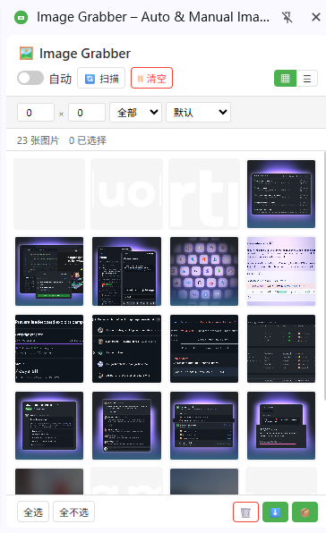

# 图片抓取器

[English](../README.md) | 中文 | [Español](README_es.md) | [Deutsch](README_de.md) | [日本語](README_ja.md) | [Français](README_fr.md)

**Image Grabber** 是一款免费的网页图片下载器扩展（Chrome / Edge），自动扫描网页中的图片并支持一键批量下载。

> 基于 Chromium · Manifest V3 · 无追踪 · 侧边栏界面

---

## 功能特性

### 免费功能

| 功能 | 说明 |
|------|------|
| 🔍 **智能图片检测** | 扫描 ``（含 `data-src` / 懒加载属性）、`srcset`（取最大候选）、CSS `background-image`（内联、`::before`、`::after`）、`<video poster>`、`<source srcset>` 和 SVG `<image>` |
| 💎 **原图识别** | 自动发现页面中暴露的高清原图（懒加载 `data-*` 属性、图片外链、`<picture>` / `srcset` 候选），先探测真实尺寸再采用；只有确认比当前显示图更大时才切换，否则回退到显示图。可用 **Original** 开关关闭 |
| 🤖 **自动采集** | 页面加载时持续收集图片（MutationObserver + 空闲回调） |
| 📋 **网格与列表视图** | 在缩略图网格和紧凑表格视图之间切换 |
| 🔎 **过滤与排序** | 按最小尺寸和图片类型过滤；按宽度、高度或文件名排序 |
| 🎯 **手动拾取** | 直接点击页面上的元素抓取它的图片 |
| 🖼️ **灯箱预览** | 大图预览，支持键盘导航（← → Esc）、下载与复制链接 |
| 🔗 **复制链接** | 把选中的（或当前筛选出的全部）图片 URL 复制到剪贴板 |
| 📥 **批量下载（单次最多 30 张）** | 每张图片由扩展面板页面携带页面 Cookie 与 `Referer` 取回，再以 blob 交给浏览器下载引擎——防盗链或需登录的图片保存下来的是真实文件，而不是 403 错误页。下载期间请保持面板打开 |
| 📊 **下载结果反馈** | 一批下载结束后，用提示条汇报成功与失败的数量 |
| 💾 **状态持久化** | 图片列表和你的「已删除」记录在页面刷新、Service Worker 重启后依然保留 |
| 🔄 **SPA 支持** | 检测真实导航与 `pushState` / `replaceState` / `popstate`；自动清空上一页图片并重新扫描新页面 |

### 高级功能（需要授权）

| 功能 | 说明 |
|------|------|
| ⭐ **无限选择** | 无 30 张限制，随意选择和下载 |
| 🔬 **pHash 去重** | 感知哈希算法识别重复/相似图片，即使 URL 不同也能检测 |
| 🔄 **格式转换** | 下载时转换为 JPG、PNG 或 WebP。GIF、SVG、AVIF 等源格式保持原样，不做有损重编码 |
| 🗜️ **图片压缩** | 调整质量和最大宽度，减小文件体积。选择 **Original** 且不缩放时，直接下载原始字节，不做重编码 |
| 🚀 **高级下载流水线** | 一键流水线：去重 → 转格式/缩放（仅在需要时）→ 下载 |

---

## 免费版 vs 高级版

| | 免费版 | 高级版 |
|---|:---:|:---:|
| 图片扫描和浏览 | ✅ 无限 | ✅ 无限 |
| 复制图片链接 | ✅ | ✅ |
| 批量下载限制 | 每次 30 张 | 无限 |
| 基础下载（原格式） | ✅ | ✅ |
| 防盗链 / 需登录的下载 | ✅ | ✅ |
| pHash 去重 | — | ✅ |
| 格式转换（WebP→JPG/PNG） | — | ✅ |
| 图片压缩 | — | ✅ |
| 高级下载流水线 | — | ✅ |

---

## 预览

  

---

## 支持的浏览器

| 浏览器 | 状态 |
|--------|------|
| Google Chrome | ✅ 完全支持（侧边栏） |
| Microsoft Edge | ✅ 完全支持（侧边栏） |
| 其他 Chromium 浏览器 | ✅ 支持（弹窗降级） |

---

## 界面说明

| 界面 | 打开方式 | 提供的能力 |
|------|----------|------------|
| **侧边栏** | 点击工具栏图标（Chrome / Edge） | 完整界面，包含输入授权码的 ⚙️ 设置面板，另加 🎯 **手动拾取** |
| **弹窗** | 在不支持侧边栏 API 的浏览器上自动启用；侧边栏无法打开时也会降级到此 | 网格/列表浏览、过滤、选择与下载 |
| **独立标签页** | 侧边栏不可用时自动作为降级方案打开 | 网格浏览、过滤、选择与下载 |

---

## 安装

| 商店 | 链接 |
|---|---|
| Chrome 应用商店 | [在 Chrome 中安装](https://chromewebstore.google.com/detail/chahehfnmhgnekhnnlmnganffejjaocc) |
| Microsoft Edge 加载项 | [在 Edge 中安装](https://microsoftedge.microsoft.com/addons/detail/peiilcogdklfmnlioikcmdkgmnlpobke) |

> 请只通过上方官方商店安装，避免使用第三方下载站。

---

## 使用方法

1. **浏览任意网页** —— 内容脚本会采集当前页面的图片
2. **点击图片抓取器图标**打开侧边栏
3. **开启自动** —— 切换「自动」开关，在页面加载时持续收集图片
4. **或点击扫描** —— 手动触发一次全页扫描
5. **过滤** —— 设置最小宽度/高度，选择图片类型，选择排序方式
6. **切换视图** —— 在网格（▦）和列表（☰）布局之间切换
7. **选择** —— 点击图片进行选择（免费用户最多 30 张）
8. **预览** —— 点击任意图片打开灯箱
9. **复制** —— 用复制按钮把选中图片的链接放到剪贴板
10. **下载** —— 点击 ⬇️ 基础下载，或 ⭐ 高级下载（需授权）。完成后提示条会汇报成功与失败的数量。下载由面板页面执行，请保持面板打开直到本批结束

### 高级下载（需授权）

1. 前往 [annmax1983.com](https://www.annmax1983.com/checkout.html?plugin=imagegrabber) 获取授权码
2. 打开设置（⚙️ 齿轮图标）→ 输入授权码
3. 配置输出格式、质量和去重选项
4. 选择图片后点击 ⭐ 高级下载按钮
5. 流水线自动执行：去重（如启用）→ 转格式/缩放（仅在你选择了格式或最大宽度时）→ 下载

转换目标仅限 JPG、PNG、WebP。GIF、SVG、AVIF、BMP 等格式保持原格式下载（如果你请求了转换，会计入降级数量）。选择 **Original** 且最大宽度为 0 时，无论质量滑块如何设置，都直接下载原始字节而不重编码。

---

## 隐私

- 所需权限：`storage`、`downloads`、`sidePanel`、`declarativeNetRequest`
- 需要 `<all_urls>` 主机权限，才能检测并下载任意域名下的图片
- `declarativeNetRequest` 仅用于设置 `Referer` 请求头。面板展示某个标签页的图片期间规则保持生效（让防盗链站点的缩略图也能显示），下载批次期间同样生效（让保存下来的文件是真正的原图而非错误占位图）。规则只作用于当前屏幕上出现的图片域名，并在关闭面板、切换标签页或页面跳转时移除
- 规则生效期间，它作用于发往这些图片域名的请求，而不只是扩展自身的取图请求——批次期间页面对同一图片域名的请求也会带上页面 `Referer`。规则是会话级、按域名生效的，不会永久改写请求头
- SPA 导航通过比较 `location.href` 在本地检测，不读取、不记录、不上传任何浏览历史
- 原图识别会用临时图片加载在本地探测候选地址，请求直接发往图片所在站点（与页面加载图片的站点相同）。只读取尺寸，不上传、不保存图片内容，验证结果仅存于本地存储；可通过 **Original** 开关关闭
- 所有图片处理均在**浏览器本地运行**，无外部数据上传
- 无分析、无追踪、无数据收集
- 图片数据仅存储在浏览器本地存储中
- 授权验证发送许可证密钥、随机安装标识和基础浏览器信息 —— 绝不包含图片、页面内容或浏览数据

---

## 版权声明

本扩展仅提供本地图片资源查看和下载能力，供用户个人离线整理和参考使用。网页上的所有图片、插画、图形素材受版权和知识产权法保护。用户不得将批量下载的图片用于商业制作、未授权转载、二次分发、大规模爬取等侵权行为。因不当使用产生的一切民事和法律责任由用户自行承担。

## 爬取合规提示

请勿使用此工具从具有版权保护、反爬机制或明确内容使用限制的网站批量抓取图片资源。扫描页面图片时请遵守网站访问规则和当地法规。

---

## 源码说明

本仓库包含扩展的完整源码：manifest、内容脚本、Service Worker、全部 UI、语言文件和构建脚本。扩展同时通过 Chrome Web Store 分发。

---

## 许可证

Copyright © 2026 Image Grabber. 保留所有权利。

---

> **注意：** 源码在此仓库中公开以保持透明。

---

## ❤️ 支持开发者

如果图片抓取器对你有帮助，请考虑请我喝杯咖啡！

**[👉 点击此处支持](https://ko-fi.com/annmax?ref=imagegrabber)**
